<a href="https://cv-yusuf-mirlanuulu.vercel.app">
  <picture>
    <source media="(prefers-color-scheme: dark)" srcset="dark_mode.svg">
    
  </picture>
</a>

  <a href="https://cv-yusuf-mirlanuulu.vercel.app"><b>Резюме</b></a> ·
  <a href="https://cv-yusuf-mirlanuulu.vercel.app/Yusuf-Mirlan-uulu-Frontend-CV.pdf">PDF</a> ·
  <a href="https://t.me/YusMrln">Telegram</a> ·
  <a href="mailto:mirlanuulu.04@gmail.com">Email</a>

### Избранные проекты

| Проект | Что это | Стек |
|---|---|---|
| **[ABM Express](https://cargo-rouge.vercel.app)** | Система для карго-компании Китай → Бишкек: лендинг, кабинет клиента и админка на 4 роли — приёмка и выдача посылок, импорт реестров Excel, журнал действий, дашборд. Передана владельцу | Next.js · TypeScript · Postgres · Drizzle |
| **[domix.kg](https://domix.kg)** | Интернет-магазин под предзаказ: каталог, корзина с заказом в WhatsApp, админка товаров и скидок. Через него идут реальные заказы | React · Vite · Zustand · Supabase |
| **WhatsApp-бот для domix** | AI-продавец: подбирает товары из базы, считает итог, оформляет заказ после подтверждения и шлёт его менеджерам в Telegram. 57 тестов | TypeScript · Node.js · LLM API |
| **[glee](https://glee-lovat.vercel.app)** | Сайты-приглашения на той: конверт с печатью, таймер, RSVP в Telegram, KG/RU. Новый заказ — это конфиг, а не правка кода | Next.js · GSAP · Lenis |

> Код коммерческих проектов закрыт — покажу на созвоне.
